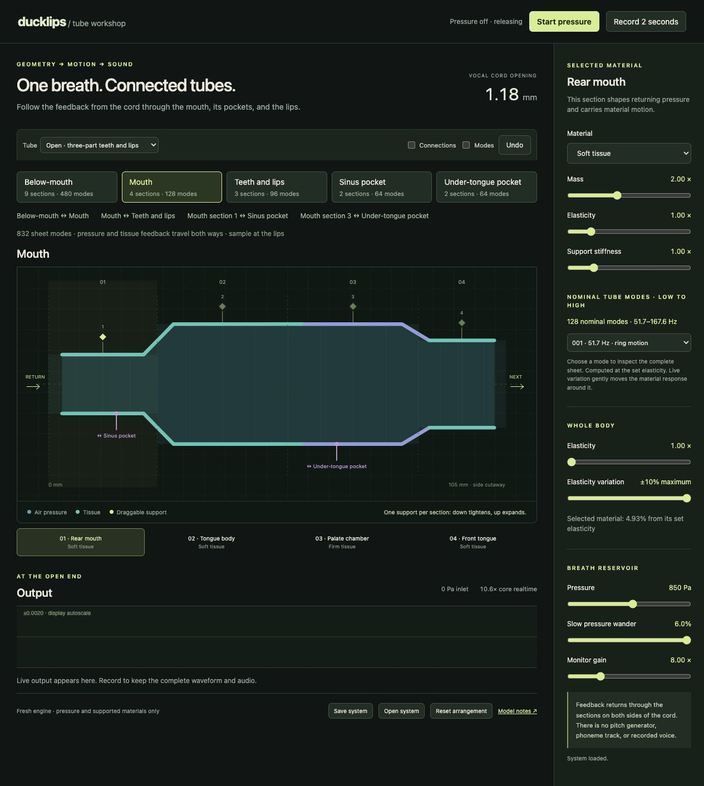

# Connected tube experiments — 2026-10-10

The user accepted the below-mouth model at `f83173c` and authorized chaining the
remaining parts, trying different combinations of their segments. The accepted
nine-section design is retained exactly in every arrangement. No further literal
mirroring is imposed on the new stages.

The resulting topology is below-mouth ↔ mouth ↔ teeth/lips, with closed sinus
and under-tongue pockets branching from the mouth. Each connection carries causal
bidirectional air-pressure and tissue-velocity waves. Only the original source
inlet is pressurized, and the output is sampled at the lips. The editor selects
one of five tubes; every section keeps one ring handle.

## Fresh comparisons

Each final recording contains 1.6 seconds at 48 kHz after one second of settling.
Every experiment was depicted with the preserved enhanced renderer and visually
inspected at its full native **684 × 301 cells**, in magma. The display PNG repeats
each column four times; it does not interpolate or discard cells. All 76,800 audio
samples are included. There is no ordinary-STFT comparison image.

| Arrangement | Structural difference | Modes | Raw peak | Raw RMS | WAV SHA-256 |
| --- | --- | ---: | ---: | ---: | --- |
| Open | Four mouth sections, wide tongue openings, soft vestibule before teeth and lips | 832 | .0100744 | .00264747 | `2bb56145aa4558bb8a3addc0b5fb637141a829e82439c8f0ea916054a4e96812` |
| Balanced | Four mouth sections, narrower front, two-part teeth/lips | 800 | .00697682 | .00196476 | `56f6f6e72aaf76bac756b92c69874a267c7a43db957bf0bbbcbe810d40055788` |
| Rounded | Three mouth sections with a long heavy soft front chamber; longer, narrower lips | 768 | .00231580 | .000512863 | `1e3142503e815797dd8ab390f4bb9156a77df85bf9edd12f0be951999af0609d` |

Visual selection: Open retains clearer lower-frequency bands and gives the
strongest lip output. Balanced and Rounded attenuate the lower region more
strongly. All three show sustained curved band trajectories. These observations
support Open as the starting geometry; they do not establish vowel identity or
human realism. The names describe geometry, and these are sustained comparisons.

Artifacts are in `out/connected-final-{open,balanced,rounded}/`: raw `outlet.wav`,
`listen.wav`, complete `design.json`, trace, frozen synthesis sources and hashes,
full enhanced images/data, and `receipt.json`. Listening copies use the same
**16× constant gain** for all three, with no filtering, normalization, fading or
time edits. Raw recordings remain intact. The final optimized kernel rendered
byte-identical WAVs to the inspected earlier kernel, so the exact paired enhanced
fields were reused, with that evidence recorded in each final receipt.

LAN listening/field pages:

- <http://192.168.1.18:8765/renders/connected-open/index.html>
- <http://192.168.1.18:8765/renders/connected-balanced/index.html>
- <http://192.168.1.18:8765/renders/connected-rounded/index.html>

## Validation and efficiency

`node --test web/tube/*.test.mjs`: **35 passed**, including exact native/JS sample
parity, contact, changing elasticity, fractional delays, geometry changes with
preserved state, downstream-to-source feedback for every branch, child evaluation
order independence, silent rest, pressure-off ringdown, topology changes, and
identical raw capture with Worklet/LAN buffer sizes. [Test receipt](tests.txt).

Twenty-second runs for all three arrangements at global elasticity 1 and 4
completed without a model fault. Actual core performance on this host ranged
**10.565–12.064× realtime**. [Timing and stability receipt](stability.json).
The app browser measured **11.1×** on localhost and **10.6–10.9×** on the LAN URL.
These are host measurements, not measurements of the separate MacBook Neo.

The initial connected JS implementation ran at about 6×. The final representation
puts the same double-precision sample operations into contiguous WebAssembly
memory. Separate constant unit-delay air loops avoid repeating the generic delay
selection per connection. Modes, sample rate, coefficients, variation and physical
feedback are unchanged. The generated module and its C/build sources are checked
in. An initial `atob` dependency prevented Worklet registration; the generated
module now uses a literal byte array and successfully runs in both transports.

Browser checks exercised localhost Worklet startup, LAN HTTP worker startup,
live mouth-support editing and Undo, stage selection, preset topology changes,
and export/import of all five tubes and all four connections. The LAN server is
bound to `0.0.0.0:8765`; HTTP access was verified from the host. The actual Neo
was not remotely controlled. Browser console errors: none in the checked LAN tab.

## Current physical scope

The sidewall picture remains an editing view over each periodic 2D sheet. Side
junctions are distributed around a ring, so this version retains the source's
rotational symmetry. The sinus pocket is a closed resonant branch, not a nasal
passage or nostril outlet. Global modal eigenanalysis of the whole branched
system is not claimed: complete per-stage modal responses are connected through
pressure and tissue transport. Dynamic articulation and phoneme gestures remain
future work on these editable stages. See [model notes](../../web/tube/MODEL.md).
