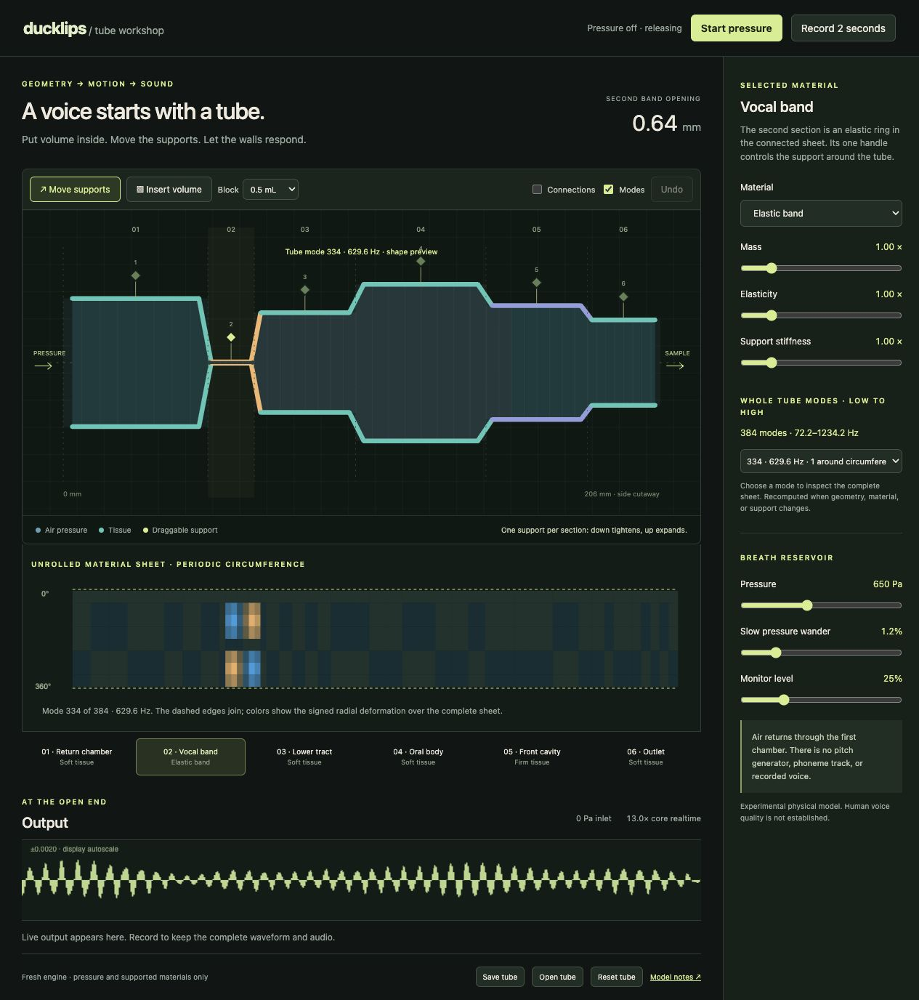

# Connected sheet replacement — 2026-10-10

The request was to make the actual engine a 2D sheet, keep at least 40 tube
modes ordered from low to high frequency, and expose one manipulation control
per section. This replaces the earlier upper/lower strip model.

Implemented a 48-by-8 periodic material sheet, joined around the circumference
and across all six sections. All 384 radial material modes are computed from
mass and stiffness and retained. Forty-eight are axisymmetric; the other 336
vary around the circumference. Default dry supported-material frequencies are
72.219–1234.164 Hz. These are not claimed as acoustic formants or measured
human material modes.

The side cutaway has six ring handles, with no U/L split. A vertical edit
changes the ring radius and both visible walls; a horizontal edit moves the
support footprint. Volume blocks and per-section material properties remain.
The mode selector lists all modes in frequency order and exposes the complete
periodic sheet for inspection. Legacy saves migrate to a single ring support
per section without overwriting the original version 1 storage.

## Verification

`node --test web/tube/*.test.mjs`: **17 passed**.

The checks include the complete periodic-sheet eigen equation for every mode,
physical frequency scaling with mass and elasticity, geometry/support effects,
exact block volume, cached-response agreement with explicit modal sums,
non-axisymmetric sheet motion and air coupling, symmetric/full-sheet agreement,
state preservation through support changes, delay-history preservation through
unchanged recompilation, pressure-free silence, contact, deterministic output,
pressure-off ringdown, legacy import, invalid parameter rejection, and PCM/raw
recording parity between the AudioWorklet and LAN buffer paths.

The full eight-sector and symmetric calculations differ by at most
6.84e-9 in output over the 5000-sample comparison, including contact. The
cached default axisymmetric response retains 262 spatial coefficients and
omits a maximum absolute row sum of 1.023e-14. Its construction uses every
mode in that angular family. No modal count was reduced to reach the speed
target.

The original dense modal implementation measured about 4x. Cached receptance,
rotation symmetry, and contiguous transport histories improved the normal
pressure-on path. Final measured Node runs were 12.25x, 12.16x and 12.06x;
the actual localhost and LAN browser pages displayed 13.0x. The connection-bank
representation alone was compared to its preceding implementation and produced
bit-identical 48000-sample core output. These speed results apply to the
normal ring-controlled, rotationally symmetric playback path on this host,
not every device or fully asymmetric diagnostic state.

Browser checks confirmed six handles and 384 selector entries. One ArrowDown
on the vocal ring changed its opening from 0.64 to 0.44 mm, changed the computed
mode spectrum, and moved both cutaway walls. Undo restored the original
configuration. Mode 334's full sheet was inspected. Both localhost AudioWorklet
and HTTP LAN Worker playback reached inlet pressure without console errors.
The host server still listens on port 8765 across the LAN. The MacBook Neo
itself was not remotely operated.

## Fresh sound and complete enhanced depiction

First inspection round:
`out/sheet-tube-round-01/outlet.wav`, with its complete enhanced field.

Final browser/LAN take:
`out/flat-tube-web/2026-10-10T18-33-30.881Z-11467f/`.

- Newly generated 2.00-second raw mono recording, 48 kHz, 96000 samples.
- Peak approximately 0.4605; live monitor was muted during capture.
- WAV SHA-256: `d9050d720d22eea2a7692f711ae218912ed062ca203e5aaf2d2e4a39bf5eb7df`.
- Both the capture receipt and enhanced receipt match that exact WAV hash.
- All seven frozen source files match their source hashes, including sheet.mjs.
- Final engine/app source differs from the captured files only in trailing
  whitespace cleanup. Subsequent benchmark fault reporting and documentation
  changes do not alter synthesis.
- Complete enhanced matrix: 684 frequency rows × 376 time columns, all 96000
  input samples. Inspected `enhanced-cells.png` at one pixel per matrix cell,
  original magma, without cropping or an ordinary-STFT companion. The web
  viewer additionally preserves the four-pixel column expansion.

Visual inspection finds low persistent bands, substantial broadband texture,
and moving structure higher up the field. It does not establish a realistic
human voice, and no listening acceptance is claimed. The topology and modal
implementation are the completed scope of this change. Contact/jet formation,
material calibration, the minimum acoustic delay and the radial-only membrane
approximation remain explicit limits in `web/tube/MODEL.md`.

Detailed machine-readable receipt: [SHEET.json](SHEET.json).
